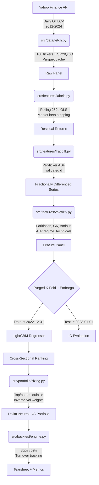

# Cross-Sectional Equity Forecasting & Friction-Adjusted Long/Short Backtest

<p align="center">
  <a href="https://github.com/Manthan-Sagar/StockAnalysis"></a>
  <a href="https://www.python.org/"></a>
  <a href="https://lightgbm.readthedocs.io/"></a>
  <a href="https://scikit-learn.org/"></a>
  <a href="https://pytest.org/"></a>
  <a href="https://opensource.org/licenses/MIT"></a>
</p>

> A quantitative research pipeline for predicting cross-sectional residual returns across ~100 liquid US equities, validated with leakage-safe purged cross-validation, sized via inverse-volatility weights in a dollar-neutral long/short portfolio, and backtested with realistic transaction costs.
>
> The emphasis is on methodological rigor. A modest Sharpe ratio from a correct methodology is more defensible than an inflated one from a flawed setup.

---

## Table of Contents

- [Pipeline Overview](#pipeline-overview)
- [Universe Construction](#universe-construction)
- [Labeling: Residual Returns](#labeling-residual-returns)
- [Feature Engineering](#feature-engineering)
- [Validation: Purged K-Fold with Embargo](#validation-purged-k-fold-with-embargo)
- [Model: LightGBM](#model-lightgbm)
- [Portfolio Construction](#portfolio-construction)
- [Backtest and Cost Model](#backtest-and-cost-model)
- [Results](#results)
- [Repository Structure](#repository-structure)
- [Quickstart](#quickstart)
- [Testing](#testing)
- [Docker](#docker)
- [Caveats and Limitations](#caveats-and-limitations)
- [License and Author](#license-and-author)

---

## Pipeline Overview



The pipeline moves through six stages: data acquisition, labeling (beta-stripped residual returns), feature engineering (volatility estimators, technicals, fractional differentiation), model training with purged CV, portfolio construction with risk-parity sizing, and backtesting with friction adjustment.

---

## Universe Construction

**Approach**: ~100 currently-listed liquid large/mid-cap US equities across 11 GICS sectors, covering 2012 to 2024.

| Sector | Count | Examples |
|---|---|---|
| Technology | 20 | AAPL, MSFT, GOOGL, NVDA, ADBE |
| Healthcare | 12 | JNJ, UNH, PFE, LLY, AMGN |
| Financials | 12 | JPM, BAC, GS, BLK, AXP |
| Consumer Discretionary | 10 | AMZN, TSLA, HD, NKE, MCD |
| Industrials | 10 | HON, UPS, BA, CAT, GE |
| Energy | 8 | XOM, CVX, COP, SLB, EOG |
| Consumer Staples | 8 | PG, KO, PEP, COST, WMT |
| Communication Services | 6 | DIS, CMCSA, NFLX, T, VZ |
| Materials | 4 | LIN, APD, ECL, NEM |
| Utilities | 4 | NEE, DUK, SO, D |
| Real Estate | 4 | AMT, PLD, CCI, EQIX |

**Survivorship bias caveat**: This universe uses currently-listed tickers only. Companies that were delisted, acquired, or dropped from indices between 2012 and 2024 are excluded. This biases returns upward and understates the difficulty of stock selection. A production system would reconstruct point-in-time index membership per rebalance date using a dataset like [fja05680/sp500](https://github.com/fja05680/sp500).

---

## Labeling: Residual Returns

Instead of predicting raw returns (which are dominated by market beta), the model targets idiosyncratic residual returns.

For each ticker `i` on day `t`, a rolling 252-day OLS regression is estimated:

```
r_stock = alpha + beta * r_market + epsilon
```

Where `r_stock` is the daily stock return and `r_market` is the daily SPY return. The residual `epsilon` is the portion of the stock's return that the market factor does not explain.

The prediction target is the **forward 5-day cumulative residual return**:

```
y(i, t) = epsilon(i, t+1) + epsilon(i, t+2) + ... + epsilon(i, t+5)
```

Rolling beta is estimated efficiently via `cov(r_stock, r_market) / var(r_market)` over a 252-day trailing window, avoiding per-row OLS overhead.

---

## Feature Engineering

All features are computed strictly per-ticker to prevent cross-asset leakage.

### Volatility and Microstructure Features

| Feature | Description |
|---|---|
| **Fractional Differentiation** | FFD applied to `log(Close)`. Per-ticker ADF-validated minimum `d` that achieves stationarity while preserving maximum memory. |
| **Parkinson Volatility** | Range-based estimator using intraday high-low range. Computed as `sqrt(mean(ln(H/L)^2) / (4 * ln(2)))` over 10-day and 20-day windows. |
| **Garman-Klass Volatility** | OHLC-based estimator. Computed as `sqrt(mean(0.5 * ln(H/L)^2 - (2*ln(2) - 1) * ln(C/O)^2))` over 10-day and 20-day windows. |
| **Amihud Illiquidity** | Price impact per unit of trading volume: `mean(abs(return) / dollar_volume) * 1e6` over a 20-day window. Higher values indicate less liquid names. |
| **Vol Regime** | Ratio of 20-day ATR to 200-day ATR. Values above 1 indicate elevated volatility relative to the long-run average. |
| **Volume Z-Score** | `(volume - mean_20d) / std_20d`. Flags unusual volume spikes. |

### Baseline Technicals

SMA (10/20/50), RSI-14, MACD, Bollinger Width, realized volatility, return lags (1/2/3/5 day), momentum (5/10/20 day).

### Cross-Sectional

Integer-encoded GICS sector (passed to LightGBM as a categorical feature) and rolling market beta.

---

## Validation: Purged K-Fold with Embargo

Standard `TimeSeriesSplit` leaks information when labels span multiple future days. A training sample near a test fold boundary can overlap the test label window, contaminating the evaluation.

`PurgedKFoldEmbargo` addresses this with two mechanisms:

1. **Purging** -- removes training samples that fall within `h` days before each test fold, where `h` is the label horizon (5 days).
2. **Embargo** -- removes an additional buffer after the test fold end to guard against serial correlation in returns.

```python
class PurgedKFoldEmbargo:
    def __init__(self, n_splits=5, label_horizon=5, embargo_pct=0.01):
        ...
    def split(self, X, y=None, groups=None):
        # Yields (train_idx, test_idx) with purge + embargo gaps
```

The test file `test_purged_cv.py` programmatically asserts that no training index falls within `h` days of any test index across all folds and configurations.

---

## Model: LightGBM

- **LGBMRegressor** targeting the forward 5-day residual return.
- Hyperparameter search via `RandomizedSearchCV` with `PurgedKFoldEmbargo` as the CV splitter.
- Search grid:
  - `num_leaves`: 15, 31, 63
  - `max_depth`: 4, 6, 8, -1
  - `learning_rate`: 0.01, 0.05, 0.1
  - `n_estimators`: 200, 500, 1000
  - `feature_fraction` / `bagging_fraction`: 0.7, 0.8, 0.9
- Sector is included as a LightGBM categorical feature (legitimate cross-sectional information).
- No ticker-specific target encoding (that would leak identity as a modelling shortcut).

---

## Portfolio Construction

At each weekly rebalance (every 5 trading days):

1. **Rank** all tickers by predicted residual return score.
2. **Select legs** -- long the top quintile (top 20%), short the bottom quintile (bottom 20%).
3. **Size positions** within each leg by inverse trailing 20-day realized volatility:
   ```
   weight(i) = (1 / vol(i)) / sum(1 / vol(j) for j in leg)
   ```
   This is risk-parity sizing: lower-volatility names receive larger weights so that each position contributes roughly equal risk.
4. **Normalize** -- long weights sum to +1.0, short weights sum to -1.0 (gross exposure 200%, net exposure 0%).

---

## Backtest and Cost Model

The backtest is vectorized in pandas. This is the right scope for a solo research project; event-driven engines (Zipline, Backtrader) add infrastructure without adding signal.

- **Gross return**: weighted sum of next-day realized returns across all positions.
- **Turnover**: `sum of |weight(i, t) - weight(i, t-1)|` at each rebalance.
- **Cost model**:
  ```
  net_return = gross_return - turnover * (8 bps / 10000)
  ```
  The 8 bps breaks down as roughly 7 bps slippage plus roughly 1 bp commission ($0.005/share at ~$50 average price). This is a stated approximation; a production desk would calibrate to their own execution analytics.
- **Performance metrics**:
  - Sharpe = `mean(daily return) / std(daily return) * sqrt(252)`
  - Sortino = same formula but using downside deviation only
  - Max Drawdown = `min(cumulative_return / running_peak - 1)`
  - Calmar = annualized return / |max drawdown|
- **Annualized turnover** is reported explicitly. It is the metric that determines whether the strategy's edge survives real-world friction.

---

## Results

The tearsheet is generated at `outputs/tearsheet.png` and includes four panels:

1. Equity curve vs. SPY and QQQ buy-and-hold
2. Drawdown chart
3. Rolling 63-day Sharpe ratio
4. Cross-sectional rank IC time series

Metrics and IC statistics are saved to `outputs/results_summary.json`.

A consistently near-zero-but-slightly-positive mean IC with a plausible t-stat is a legitimate result. The methodology is the point, not the magnitude of the numbers.

---

## Repository Structure

```
StockAnalysis/
├── data/
│   ├── raw/                  # Per-ticker parquet cache
│   └── processed/
│       ├── panel.parquet     # Full stacked (date, ticker) panel
│       └── universe.json     # Ticker list + sector mapping
├── src/
│   ├── data/
│   │   ├── fetch.py          # Cached, rate-limit-safe downloader
│   │   └── universe.py       # Static universe + sector mapping
│   ├── features/
│   │   ├── fracdiff.py       # Fractional differentiation (FFD)
│   │   ├── volatility.py     # Parkinson, GK, Amihud, ATR regime
│   │   └── labels.py         # Residual return target construction
│   ├── validation/
│   │   └── purged_cv.py      # PurgedKFoldEmbargo
│   ├── models/
│   │   └── train.py          # LightGBM + hyperparameter search
│   ├── portfolio/
│   │   ├── ranking.py        # Cross-sectional IC/IR
│   │   └── sizing.py         # L/S construction, vol-parity weights
│   ├── backtest/
│   │   └── engine.py         # Vectorized, friction-adjusted backtest
│   └── run_pipeline.py       # End-to-end orchestrator
├── tests/
│   ├── test_purged_cv.py     # Leakage prevention checks (10 tests)
│   ├── test_fracdiff.py      # Stationarity validation (12 tests)
│   ├── test_sizing.py        # Dollar-neutrality checks (11 tests)
│   └── test_backtest.py      # Synthetic backtest verification (11 tests)
├── models/                   # Trained model artifacts
├── outputs/
│   ├── tearsheet.png         # 4-panel performance report
│   ├── daily_returns.csv     # Daily portfolio returns
│   └── results_summary.json  # IC metrics + performance stats
├── notebooks/
│   └── research_walkthrough.ipynb
├── Dockerfile
├── requirements.txt
└── README.md
```

---

## Quickstart

### 1. Clone and Set Up Environment

```bash
git clone https://github.com/Manthan-Sagar/StockAnalysis.git
cd StockAnalysis

# Python 3.10+ required. Conda or venv both work.
conda activate base

pip install -r requirements.txt
```

### 2. Run the Full Pipeline

```bash
python -m src.run_pipeline
```

This runs all stages end-to-end: data download, labeling, feature engineering, model training, portfolio construction, backtesting, and tearsheet generation.

First run takes approximately 15 to 30 minutes (data download plus model training). Subsequent runs use the parquet cache and complete faster.

### 3. Force-Refresh Data

```bash
python -m src.run_pipeline --force-refresh
```

### 4. Run Individual Components

```bash
# Data acquisition only
python -c "from src.data.fetch import run_data_pipeline; run_data_pipeline()"

# Run tests
pytest -v tests/
```

---

## Testing

The test suite contains 44 tests across 4 files:

```bash
pytest -v tests/
```

```
tests/test_purged_cv.py   -- 10 tests (leakage prevention proof)
tests/test_fracdiff.py    -- 12 tests (stationarity + ADF validation)
tests/test_sizing.py      -- 11 tests (dollar-neutrality + risk-parity)
tests/test_backtest.py    -- 11 tests (synthetic backtest verification)

44 passed in 3.55s
```

`test_purged_cv.py` is the most important test file. It programmatically proves that purging and embargo prevent the temporal leakage that standard time-series CV misses.

---

## Docker

```bash
docker build -t quant-backtest .
docker run -v $(pwd)/data:/app/data -v $(pwd)/outputs:/app/outputs quant-backtest
```

The container uses `python:3.13-slim`, installs dependencies, and runs the full pipeline.

---

## Caveats and Limitations

1. **Survivorship bias** -- the universe uses currently-listed tickers only, which inflates historical returns.
2. **Transaction cost model** -- the 8 bps flat cost is an approximation. Real costs vary by name, market cap, and market conditions.
3. **No fundamental data** -- the feature set is purely price/volume-based. Point-in-time fundamentals are not included.
4. **Single market factor** -- only SPY is used for beta stripping. A multi-factor model (e.g. Fama-French) would capture more systematic risk.
5. **Sample period** -- 2012 to 2024 spans a predominantly bullish regime with unusual events (COVID, post-COVID rally, rate hikes). Out-of-sample performance across different market regimes is unknown.

---

## License and Author

- **Author**: Manthan Sagar
- **Repository**: [github.com/Manthan-Sagar/StockAnalysis](https://github.com/Manthan-Sagar/StockAnalysis)
- **License**: [MIT](LICENSE)
